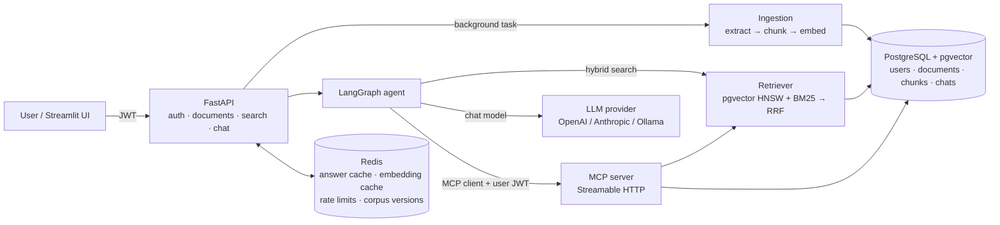
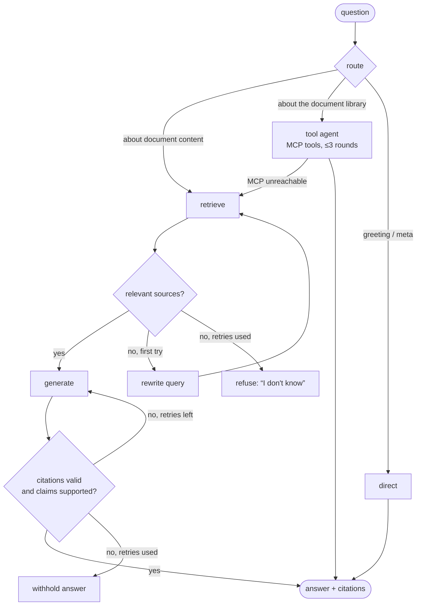

# Enterprise Knowledge Assistant

An agentic RAG application: users upload documents, then ask questions. Answers come from a
**LangGraph** agent that routes each question, runs **hybrid search** (pgvector + BM25), checks its own
answer for unsupported claims, and cites the exact document and page. The knowledge base is also exposed
through an **MCP server**, which the agent uses through an MCP client for library-level questions.

| Requirement | Where |
|---|---|
| RAG pipeline: extraction, chunking, embeddings, vector DB, semantic search | `app/ingestion/`, `app/retrieval/search.py` |
| Hybrid search: vectors + BM25 | `app/retrieval/search.py` (Reciprocal Rank Fusion) |
| LangChain + LangGraph agent: tool calling, conditional routing, state | `app/agent/graph.py` |
| MCP server (4 tools) + MCP client | `app/mcp_server.py`, `app/agent/mcp_client.py` |
| Citations + hallucination mitigation | `app/agent/graph.py` (`grade`, `verify`), `app/agent/prompts.py` |
| FastAPI REST API | `app/main.py`, `app/routers/` |
| PostgreSQL / SQLite + Redis | `app/db.py`, `app/models.py`, `app/cache.py` |
| Auth, roles, per-user data isolation | `app/security.py`, every query filtered by `owner_id` |
| Docker deployment | `Dockerfile`, `docker-compose.yml`, `.github/workflows/ci.yml` |
| Tests and evaluation | `tests/` (37 tests), `eval/` |

## Architecture



### Agent graph



### Request flow for a question

1. `POST /chat` checks the JWT, applies the per-user rate limit (Redis), and checks the answer cache.
2. **route**: the LLM classifies the question and rewrites follow-ups into standalone questions using
   the conversation history.
3. **retrieve**: hybrid search over **only this user's chunks**: pgvector cosine search plus BM25,
   merged with Reciprocal Rank Fusion. If the best cosine score is below `MIN_RELEVANCE`, there are no
   sources and the LLM is never asked to answer.
4. **grade**: the LLM keeps only the relevant sources. If none are relevant, the query is rewritten and
   retrieved once more, then the agent refuses.
5. **generate**: the LLM answers only from the numbered sources and cites them as `[S1]`.
6. **verify**: code rejects invented or missing citation ids. Then an LLM fact-check rejects claims not
   supported by the sources. A failed answer is regenerated once with that feedback, then withheld.
7. The answer, its citations (file, page, snippet) and the agent trace are returned and stored.

## Quick start (Docker)

```bash
cp .env.example .env    # set JWT_SECRET and OPENAI_API_KEY (or another provider)
docker compose up --build
```

| Service | URL |
|---|---|
| UI (Streamlit) | http://localhost:8501 |
| REST API + Swagger docs | http://localhost:8000/docs |
| MCP server (Streamable HTTP) | http://localhost:8001/mcp |

Load a demo account (`demo@example.com` / `demo-password-1`) with the sample documents. It is safe to
re-run, including after `docker compose down -v` wipes the database:

```bash
python scripts/seed_demo.py
```

Check the running stack end to end (auth, ingestion, all three search modes, isolation and MCP):

```bash
python scripts/smoke_test.py          # no LLM calls
python scripts/smoke_test.py --chat   # also asks the agent three questions
```

## Local development (no Docker)

```bash
python3.12 -m venv .venv && source .venv/bin/activate
pip install -r requirements-dev.txt
cp .env.example .env                        # SQLite + in-process cache by default
uvicorn app.main:app --reload --port 8000   # terminal 1
python -m app.mcp_server                    # terminal 2
API_URL=http://localhost:8000 streamlit run ui/streamlit_app.py   # terminal 3
```

## Tests and evaluation

```bash
pytest -q                  # 37 tests, no API key or network needed
python -m eval.run_eval    # retrieval: vector vs BM25 vs hybrid, plus the relevance gate
python -m eval.run_eval --with-llm   # adds end-to-end answer accuracy (calls the LLM)
```

The tests use a deterministic scripted chat model and a hashing embedder, so they run offline. They cover:

- **Auth:** register and login, the same error for an unknown email and a wrong password, admin role checks.
- **Ingestion:** PDF, DOCX and text extraction, page-aware chunking, rejected file types, size limits.
- **Retrieval:** the RRF maths, BM25 finding exact identifiers, hybrid ranking.
- **Agent paths:** grounded answers, refusals, invented citations, a failed fact-check, the tool route,
  MCP-outage fallback, caching, rate limiting.
- **Isolation:** another user's data never shows up in the REST API, search, chat or MCP.
- **MCP:** a **real MCP server** over HTTP with the real client, covering discovery, scoping and bad tokens.

The isolation tests were checked by deleting the `owner_id` filter on purpose: three tests fail, so
they really catch a leak.

Latest retrieval results (`eval/results.md`, 22 in-scope + 4 out-of-scope questions, `bge-small-en-v1.5`):

| Mode | hit@1 | hit@5 | MRR |
|---|---|---|---|
| vector | 1.00 | 1.00 | 1.00 |
| bm25 | 0.86 | 0.95 | 0.90 |
| hybrid | 0.95 | 1.00 | 0.98 |

On this small, mostly paraphrased question set, vector search alone is already perfect. Hybrid's value
shows on exact identifiers (error codes, version numbers, names) that embeddings blur. 26 questions is
a smoke test, not a benchmark. Re-run the eval on your own documents before you rely on these numbers.

## Configuration

All settings are environment variables (`app/config.py`). The main ones:

| Variable | Default | Purpose |
|---|---|---|
| `DATABASE_URL` | `sqlite:///./data/app.db` | `postgresql+psycopg://…` enables pgvector + an HNSW index |
| `REDIS_URL` | unset → in-process cache | Answer cache, embedding cache, rate limits |
| `LLM_PROVIDER` / `LLM_MODEL` | `openai` / `gpt-4o-mini` | Any chat model your key can access; also `anthropic`, `ollama` |
| `EMBEDDING_PROVIDER` | `fastembed` (`BAAI/bge-small-en-v1.5`, 384-d, local) | Also `openai`; `hash` is for tests only |
| `MIN_RELEVANCE` | `0.55` | Relevance gate, set from the eval (in-scope min 0.62, out-of-scope max 0.54) |
| `GROUNDEDNESS_CHECK` | `true` | LLM fact-check of every answer |
| `MAX_ATTEMPTS` | `2` | Upper limit on query rewrites and regenerations |
| `RATE_LIMIT_PER_MINUTE` | `30` | Per user, `/chat` |

## Documentation

- [docs/api.md](docs/api.md): REST endpoints and MCP tools, with examples. Live OpenAPI docs are at `/docs`.
- [docs/architecture.md](docs/architecture.md): design decisions, security model, scaling to production.
- [docs/demo.md](docs/demo.md): a step-by-step demo script.

## Project layout

```
app/
  main.py            FastAPI app, middleware, health
  config.py          all settings (env vars)
  db.py, models.py   SQLAlchemy models; pgvector on Postgres, JSON vectors on SQLite
  security.py        bcrypt, JWT, current-user and admin dependencies
  cache.py           Redis (or in-process) cache, rate limiter, corpus versions
  ingestion/         extract.py · chunking.py · embeddings.py · pipeline.py
  retrieval/         search.py (vector, BM25, RRF)
  agent/             graph.py (LangGraph) · prompts.py · llm.py · mcp_client.py
  mcp_server.py      MCP server (FastMCP, Streamable HTTP, JWT-verified)
  routers/           auth · documents/search · chat · admin
ui/streamlit_app.py  demo UI
eval/                corpus, labelled questions, run_eval.py, results.md
tests/               pytest suite
scripts/             smoke_test.py
```
